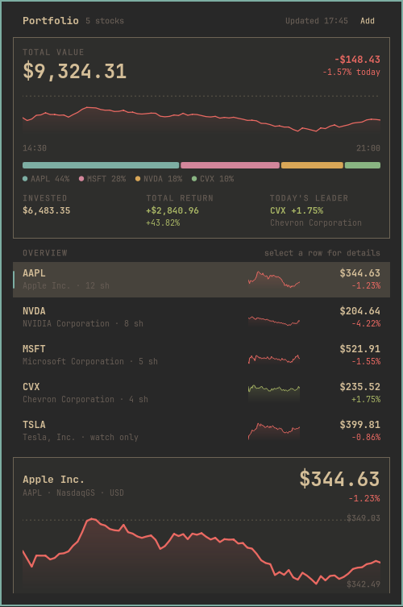

# Stocks

An Omarchy bar widget that tracks a stock portfolio: live prices, today's
move, unrealized profit/loss, and a range chart — all drawn with the active
theme's colors and fonts. The panel opens on a portfolio overview: total value,
a weighted intraday pulse chart, an allocation bar, and a compact quote list
with sparklines. Selecting a row opens the chart, key stats, and position editor.



## Install

```bash
omarchy plugin add https://github.com/KrisiBazsi/omarchy-stocks.git --enable
omarchy bar move lipi.stocks right
```

The widget needs `curl` (already present on Omarchy) and an internet connection
for quotes. It has no API key or account setup.

To remove it:

```bash
omarchy plugin remove lipi.stocks
```

## Usage

- **Left click** the bar readout to open the portfolio panel.
- **Middle click** opens the panel with the search field focused.
- **Right click** refreshes quotes immediately.

Inside the panel:

| Action | How |
| --- | --- |
| Add a ticker | Click **Add** in the header, then type in the search field and pick a result (or press Enter to add the raw symbol) |
| Set shares / average cost | Click a holding row to show its detail card, fill in the fields, then **Save** |
| Watch a ticker without owning it | Leave shares at `0` |
| Change chart range | Click `1D 5D 1M 6M 1Y` |
| Remove | Open the row editor, click **Remove**, then confirm |
| Navigate | Arrow keys move between holdings (up/down) and ranges (left/right) |
| Jump to search | `/` |
| Refresh | `r` |
| Edit selected | `e` |
| Close | `Esc` |

The bar can show today's move in percent (default), the move in money, the
total market value, or just the icon — set `barDisplay` in `shell.json`.

## Settings

Add these to the widget's entry in `~/.config/omarchy/shell.json`:

```json
{
  "id": "lipi.stocks",
  "barDisplay": "percent",
  "refreshSeconds": 60,
  "showIcon": true,
  "showSparklines": true
}
```

| Key | Values | Default |
| --- | --- | --- |
| `barDisplay` | `percent`, `change`, `value`, `icon` | `percent` |
| `refreshSeconds` | 30–600 | `60` |
| `showIcon` | boolean | `true` |
| `showSparklines` | boolean | `true` |

## Portfolio data

Holdings are stored as plain JSON in:

```
~/.local/state/omarchy/stocks.json
```

```json
{
  "version": 1,
  "holdings": [
    { "symbol": "AAPL", "name": "Apple Inc.", "shares": 12, "cost": 178.4 },
    { "symbol": "NVDA", "name": "NVIDIA Corporation", "shares": 0, "cost": 0 }
  ]
}
```

The file is created on the first edit and is watched, so external changes are
picked up immediately. Symbols use Yahoo Finance notation (`BRK-B`, `^GSPC`,
`BTC-USD`, `EURUSD=X`).

## Market data

Quotes come from Yahoo Finance's public, key-less endpoints:

- `v7/finance/spark` — batched price + intraday series for all holdings.
- `v8/finance/chart` — the selected range for the chart.
- `v1/finance/search` — ticker search.

Requests are made with `curl`; there is no API key and nothing is sent
anywhere except the ticker symbols. Prices are delayed by the exchange, as with
the Yahoo Finance website, and the widget shows the last known values when the
network is unavailable.

## Commands

```bash
omarchy-shell lipi.stocks toggle
omarchy-shell lipi.stocks refresh
```
